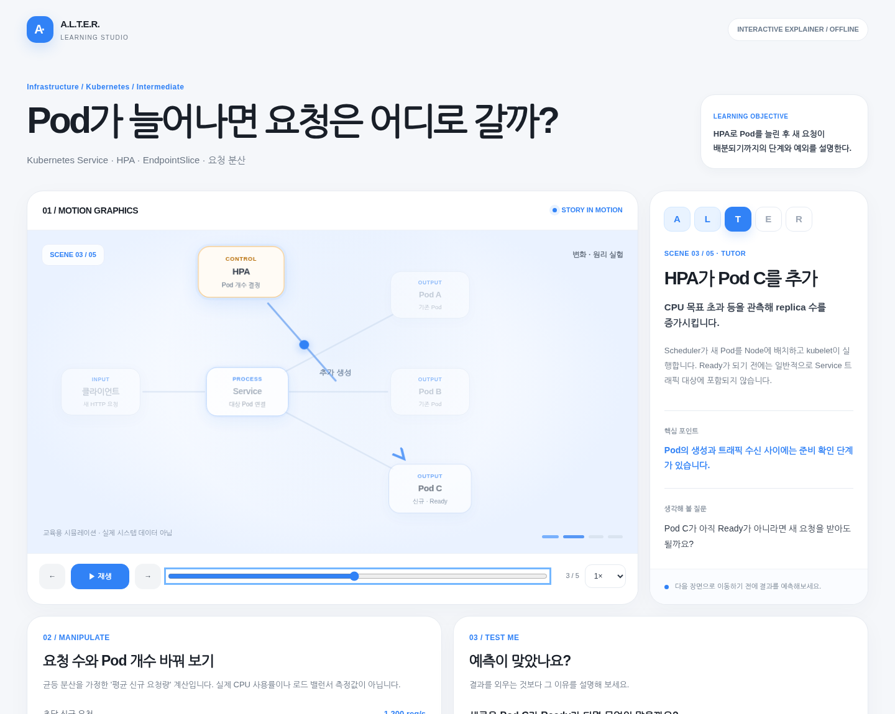
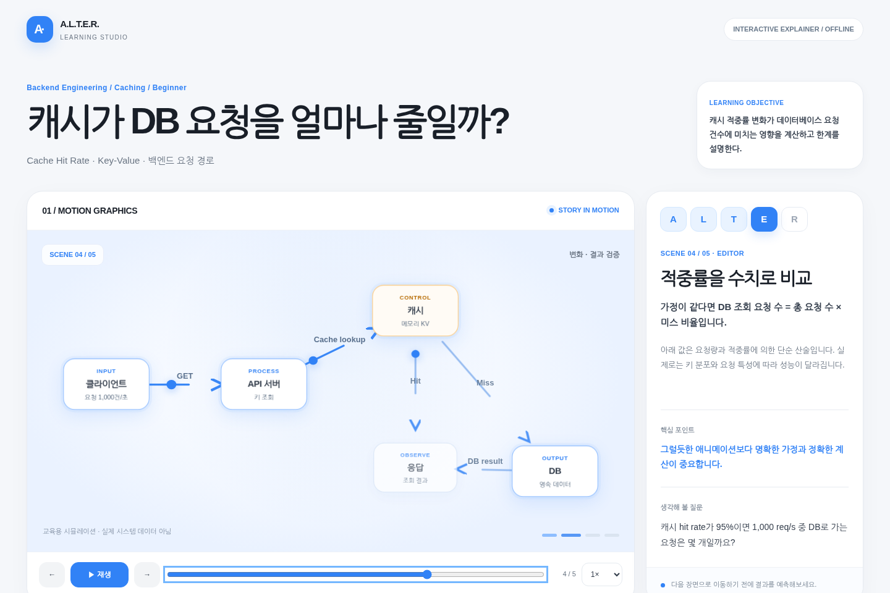
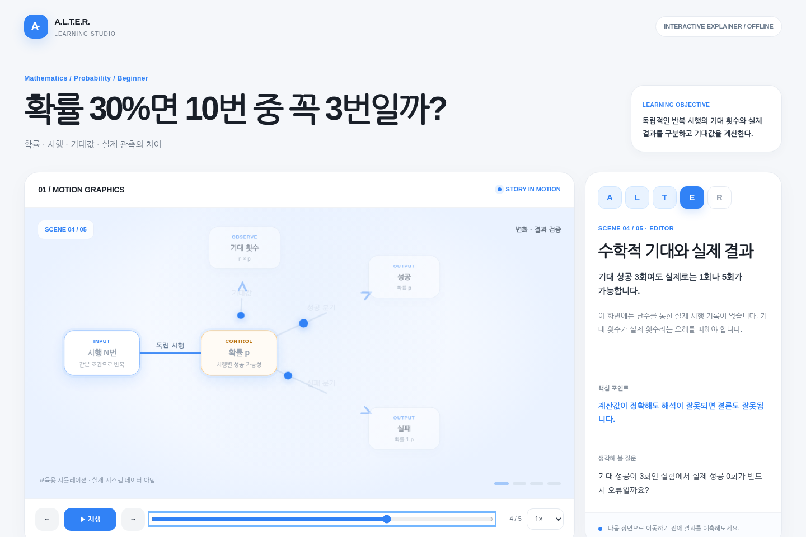
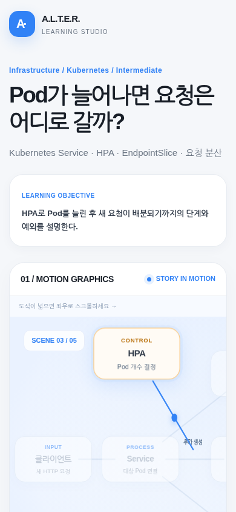

<div align="center">

# A.L.T.E.R. Learning Studio

**AI를 조언자·사서·튜터·편집자·룸메이트로 나눠, 혼자서도 과외처럼 공부하는 에이전트 스킬**

배우고 싶은 주제를 말하면 학습 계획을 세우고, 직접 만져 볼 수 있는 모션그래픽 HTML 수업까지 만들어 줍니다.


<br/>



<sub>예시 수업 화면 · 장면을 넘기고, 속도를 바꾸고, 퀴즈로 이해를 확인합니다</sub>

</div>

<br/>

## 왜 만들었나요?

1대1 과외를 받은 학생이 일반 수업 학생보다 크게 앞선다는 연구(블룸의 2 시그마)가 있습니다. 문제는 비용입니다. AI에게 질문만 던지면 답만 받고 끝나기 쉬우니, **AI에게 역할을 나눠 주고 학습 절차를 구조화**하는 쪽을 택했습니다.

> 학습 효과를 보장하는 도구는 아닙니다. 혼자서도 과외처럼 공부할 수 있는 틀을 만들어 줍니다.

## A.L.T.E.R. 다섯 역할

| | 역할 | 하는 일 |
|:-:|---|---|
| **A** | Academic Advisor<br/>조언자 | 목적지, 현재 수준, 학습 순서, 버릴 것, 확인할 이정표를 정합니다. |
| **L** | Librarian<br/>사서 | 학습 주제마다 믿을 만한 자료 3~4개만 골라 줍니다. |
| **T** | Tutor<br/>튜터 | 먼저 예측하게 한 뒤 설명합니다. `Teach me` / `Test me` 모드로 이해의 구멍을 메웁니다. |
| **E** | Editor<br/>편집자 | 내 설명에서 처음 틀어진 곳을 짚고, 근거를 들어 점수를 매깁니다. |
| **R** | Roommate<br/>룸메이트 | 다른 분야와 연결하고, 비유가 맞는 곳과 틀리는 곳을 함께 보여 줍니다. |

모든 수업은 **A → L → T → E → R** 순서로 흐릅니다.

## 무엇을 만들어 주나요?

- **학습 계획과 진행 기록**: `learning/PLAN.md`, `learning/PROGRESS.md`로 저장하고, 다음에는 마지막 챕터부터 이어서 시작합니다.
- **오프라인 모션그래픽 HTML 수업**: 인터넷 연결, CDN, 텔레메트리 없이 브라우저에서 열립니다.
  - 장면 3~7개, 장면마다 *원인 → 변화 → 전이 → 결과* 4박자 연출
  - 재생·일시정지, 연속 스크럽, 속도 조절, 이전/다음
  - 직접 값을 바꿔 보는 모델, 피드백이 있는 퀴즈, 출처와 가정 표시
  - 접근성 레이블과 모션 줄이기(reduce-motion) 지원
- **사실 구분 표기**: `[FACT]`, `[MODEL]`, `[ANALOGY]`, `[OPEN QUESTION]`으로 사실, 단순화한 모델, 비유, 미확인을 나눠 적습니다.

기본 디자인은 흰색·연회색 바탕에 파란 포인트(`#3182F6`)를 쓰는 토스 분위기의 **자체 구현**입니다. 공식 Toss 컴포넌트, 폰트, 아이콘, 로고는 쓰지 않습니다.

## 설치

### 플러그인으로 설치 (권장)

Claude Code 안에서 마켓플레이스를 등록하고 플러그인을 설치합니다.

```text
/plugin marketplace add sangwookp9591/alter-learning-studio
/plugin install alter-learning-studio@alter-learning-studio
```

한 줄로 설치할 수도 있습니다(Claude Code 2.1.275 이상).

```text
/plugin install alter-learning-studio --marketplace sangwookp9591/alter-learning-studio
```

설치 뒤 `/reload-plugins`를 실행하거나 새 세션을 열면 적용됩니다. 스킬은 플러그인 이름이 앞에 붙은 이름으로 호출됩니다.

```text
/alter-learning-studio:alter-learning-studio 주제: HTTP와 HTTPS의 차이 ...
```

업데이트는 `/plugin marketplace update alter-learning-studio` 후 다시 설치합니다.

### 스킬 폴더만 복사해서 설치

플러그인 없이 스킬 폴더만 쓰고 싶다면 저장소를 클론한 뒤 `skills/alter-learning-studio` 폴더를 복사하세요. 폴더 이름은 `alter-learning-studio`로 둡니다.

```bash
git clone https://github.com/sangwookp9591/alter-learning-studio.git
# Claude Code (모든 프로젝트)
cp -R alter-learning-studio/skills/alter-learning-studio ~/.claude/skills/
# Claude Code (현재 프로젝트만)
mkdir -p .claude/skills && cp -R alter-learning-studio/skills/alter-learning-studio .claude/skills/
# Codex (프로젝트의 .agents/skills/)
mkdir -p .agents/skills && cp -R alter-learning-studio/skills/alter-learning-studio .agents/skills/
```

`agents/openai.yaml`이 스킬 폴더에 포함되어 있습니다. Codex의 전역 경로는 사용 중인 Codex 버전의 문서를 확인하세요. 이 방식은 플러그인과 달리 이름 앞에 플러그인 이름이 붙지 않아 `/alter-learning-studio`로 호출합니다.

## 사용법

### 처음 공부하기

```text
$alter-learning-studio
주제: HTTP와 HTTPS의 차이
내 수준: 백엔드 개발 경험은 있지만 TLS 핸드셰이크는 잘 모름
목표: 요청이 암호화되는 과정과 인증서 검증을 그림으로 설명하고 싶음
A.L.T.E.R. 방식으로 핵심 챕터를 구성하고 가장 중요한 개념을
오프라인 HTML 모션그래픽으로 만들어줘. 가정/실제 동작을 구분해줘.
```

### 이어서 공부하기

```text
$alter-learning-studio
현재 저장소의 learning/PLAN.md 와 learning/PROGRESS.md를 읽어
마지막 완료 챕터 이후부터 이어서 학습시켜줘.
먼저 2개 문제로 이해도를 진단하고 다음 실습을 제시해줘.
```

Claude Code에서는 `$alter-learning-studio` 대신 `/alter-learning-studio:alter-learning-studio`(플러그인) 또는 `/alter-learning-studio`(폴더 복사)로 호출할 수 있습니다. 더 많은 프롬프트(시각화만 만들기, 전혀 다른 분야 학습, 여러 에이전트로 조사·구현·검증, 영상까지)는 [`PROMPTS_KO.md`](skills/alter-learning-studio/PROMPTS_KO.md)에 있습니다.

## 예시 수업 (직접 열어 보세요)

저장소를 클론한 뒤 `skills/alter-learning-studio/examples/` 안의 HTML을 브라우저로 열면 됩니다. 서버나 설치가 필요 없습니다.

<table>
<tr>
<td width="50%" align="center">
<br/>
<b>캐시가 DB 요청을 얼마나 줄일까?</b><br/>
<sub><a href="skills/alter-learning-studio/examples/cache-hit-rate.html">cache-hit-rate.html</a> · 백엔드 / 캐싱</sub>
</td>
<td width="50%" align="center">
<br/>
<b>확률과 기댓값</b><br/>
<sub><a href="skills/alter-learning-studio/examples/probability-expected-value.html">probability-expected-value.html</a></sub>
</td>
</tr>
<tr>
<td width="50%" align="center">
<br/>
<b>Pod가 늘어나면 요청은 어디로 갈까?</b><br/>
<sub><a href="skills/alter-learning-studio/examples/kubernetes-service.html">kubernetes-service.html</a> · 인프라 / Kubernetes</sub>
</td>
<td width="50%" align="center">
<br/>
<b>모바일 레이아웃</b><br/>
<sub>좁은 화면에서도 가로 스크롤 없이 동작합니다</sub>
</td>
</tr>
</table>

전체 목록은 [`examples/index.html`](skills/alter-learning-studio/examples/index.html)에서 볼 수 있습니다.

## 직접 수업 만들기

수업은 실행 코드가 아니라 **데이터(JSON)** 로 정의합니다. 스크립트가 검증한 뒤 오프라인 HTML로 빌드합니다. 외부 패키지가 필요 없습니다.

```bash
cd skills/alter-learning-studio

# JSON 수업을 HTML로 빌드
python3 scripts/build_lesson.py --input learning/lesson.json --output learning/lesson.html

# 검증만 실행
python3 scripts/build_lesson.py --input learning/lesson.json --validate-only

# 예시 빌드
python3 scripts/build_lesson.py \
  --input assets/examples/cache-hit-rate.json \
  --output examples/cache-hit-rate.html

# 스킬 구성 검증
python3 scripts/validate_skill.py
```

수업 JSON 형식은 [`references/lesson-schema.md`](skills/alter-learning-studio/references/lesson-schema.md)를 보세요. Playwright가 설치되어 있다면 `scripts/smoke_browser.py`로 브라우저 동작과 스크린샷도 점검할 수 있습니다.

## 지키는 원칙

- **외우기보다 적용**: 예측 → 최소 설명 → 직접 조작 → 확인 → 전이 순서로 가르칩니다.
- **정적인 순서도는 모션그래픽이 아닙니다**: 개념 자체가 움직여야 합니다. 장식용 점은 인정하지 않습니다.
- **실제로 확인한 것만 확인했다고 말합니다**: 브라우저 검증을 하지 않았다면 했다고 쓰지 않습니다.
- **시뮬레이션은 실측이 아닙니다**: 슬라이더가 바꾸는 값의 가정과 단위를 표시합니다.
- **안전**: `eval`, 원격 import, 외부 폰트, 수업 JSON 안의 임의 HTML을 허용하지 않습니다. 의료·법률·금융·위험 실험은 주의 문구와 함께 다룹니다.
- **영상은 렌더한 뒤에만**: HTML 모션그래픽은 영상 파일이 아닙니다. MP4/GIF는 실제로 녹화·렌더한 경우에만 제공합니다.

## 구성

```text
alter-learning-studio/
├── .claude-plugin/
│   ├── marketplace.json          # 마켓플레이스 등록 정보
│   └── plugin.json               # 플러그인 매니페스트
├── README.md
└── skills/alter-learning-studio/
    ├── SKILL.md                  # 스킬 진입점 (절차와 계약)
    ├── PROMPTS_KO.md             # 바로 쓰는 한국어 프롬프트 모음
    ├── agents/openai.yaml        # Codex 메타데이터
    ├── assets/                   # 플레이어 템플릿, 토큰, 예시 수업 JSON
    ├── references/               # 다섯 역할, 스키마, 시각화·모션 가이드, 품질 기준
    ├── scripts/                  # build_lesson / validate_skill / smoke_browser
    └── examples/                 # 빌드된 예시 HTML과 미리보기
```

## 참고

- 학습 효과의 크기는 블룸의 2 시그마 연구 인용이며, 이 스킬을 쓴 결과를 보장하지 않습니다.
- 자료의 출처와 적용 한계는 [`references/sources.md`](skills/alter-learning-studio/references/sources.md)에 정리되어 있습니다.
